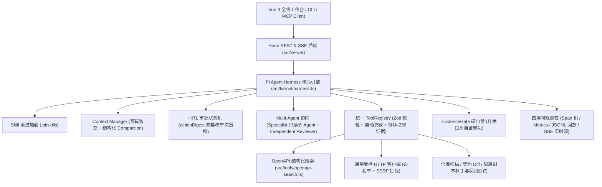

# A-Pidoc v2 · Pi-Powered Agent Harness

**基于 Pi Agent 内核的全栈 API 联调诊断、契约迁移与可观测评测工作台。**

[](package.json)
[](src/)
[](web/)
[](src/server/app.ts)
[](https://github.com/LarryBUPT/A-Pidoc/actions/workflows/ci.yml)

---

## 核心定位与设计哲学

A-Pidoc v2 遵循 **Pi Agent（`@earendil-works/pi-agent-core@0.85.1`）** 的极简内核哲学：**模型负责自主规划与工具选择，Harness 负责上下文工程、权限审批、沙箱隔离、证据核验与全链路可观测**。

相比传统的确定性脚本或“无护栏裸 Agent”，A-Pidoc v2 提供一套干净分层、全栈可视化、可回放评测的工程级 Agent Harness：



## 核心特性

1. **清晰可掌控的 Agent Harness 内核（`src/kernel/`）**：
   - 基于 `@earendil-works/pi-agent-core` 驱动多轮工具调用循环，外层严格控制模型调用数、工具数、Token、成本与超时预算及指数退避重试。
2. **上下文工程与渐进式 Skill（`context-manager.ts` / `skill-loader.ts` / `openapi-search.ts`）**：
   - 启动时仅暴露 `.pi/skills/` 技能目录，运行时按需通过 `load_skill` 加载规程；
   - 面对多端点 OpenAPI 文档，通过结构化索引与加权检索按需召回接口 Schema；
   - 上下文达到预算 72% 阈值时自动触发结构化 **Compaction 压缩**，保留任务目标与 Evidence 索引。
3. **安全边界与 Human-in-the-Loop 审批（`approval-gate.ts` / `request-policy.ts`）**：
   - 只读工具自动放行；写操作与状态变更请求（支付扣款、隔离补丁、回归测试）强制挂起为 `waiting_approval`，前端实时弹出审批卡片；
   - 批准与 `actionDigest = sha256(toolName + args)` 单次绑定，防止参数篡改与重放；HTTP 客户端内置 Host/Port 白名单与 DNS SSRF 私网拦截。
4. **Multi-Agent 协同与防幻觉双重核验（`multi-agent.ts` / `evidence-gate.ts`）**：
   - **Specialist Subagent**：隔离上下文的只读子 Agent，承担大文档/源码深度排查，避免主上下文污染；
   - **EvidenceGate + Independent Reviewer**：硬门禁先校验每条结论引用的 SHA-256 真实工具观测，通过后再由独立无工具 Reviewer 子 Agent 复核逻辑一致性，不通过可触发反思纠错或人工接管。
5. **四层可观测性与 Raw vs Harness 评测（`telemetry.ts` / `eval/runner.ts`）**：
   - 完整记录嵌套 Trace Span 树、TTFT/Token/成本/压缩次数 Metrics、JSONL 时序事件流与 SSE 实时推送；
   - 提供 Raw Pi vs Harness Pi 5 大对照评测场景（正确率、防幻觉、HITL 安全、SSRF 防护、上下文压缩）。
6. **标准 stdio MCP Server（`src/mcp/server.ts`）**：
   - 将受控的 OpenAPI 检索、白名单 HTTP 探测、仓库扫描与防篡改证据读取以标准 MCP 暴露给 Cursor / Claude Code 等 AI 工具。

---

## 快速开始

需要 **Node.js ≥ 22.19**。在仓库根目录执行：

```bash
# 1. 安装前后端依赖并构建
npm ci
npm --prefix web ci
npm run build:all

# 2. 启动全栈服务（内置 8 端点电商诊断靶场 + Hono SSE 后端 + Vue 3 工作台）
npm run serve
```

浏览器打开 **http://127.0.0.1:3000** 即可体验三大视图：
- **实时诊断台**：支持免密钥 `Mock` 演示或接入 `.env` 中的 `DEEPSEEK_API_KEY` 运行 `DeepSeek Live` 真实推理，一键体验 SSE 流式轨迹与 HITL 人工审批弹窗；
- **Trace 可观测与回放**：查看嵌套 Span 瀑布图、TTFT/Token/成本指标与逐帧轨迹回放器；
- **Raw vs Harness 评测看板**：查看并重跑离线/Live 对照评测。

### 常用命令

| 命令 | 说明 |
| --- | --- |
| `npm run serve` | 构建后端并启动全栈服务（端口默认 `3000`） |
| `npm run check` | 运行后端编译、单元测试与离线 Raw vs Harness 评测 |
| `npm run build:all` | 同时构建 TypeScript 后端与 Vue 3 前端 |
| `npm run eval:offline` | 运行 5 大对照场景离线评测（零密钥） |
| `npm run eval:live` | 复用 `.env` 中 `DEEPSEEK_API_KEY` 运行真实模型对照评测 |
| `npm run mcp` | 启动标准 stdio MCP Server |

---

## 仓库目录

```text
A-Pidoc/
├── .pi/skills/            # 渐进式领域 Skills（api-debug / contract-migration）
├── src/
│   ├── kernel/            # Pi Agent Harness 核心引擎（Loop/Context/Skill/Approval/Evidence/Multi-Agent/Telemetry）
│   ├── tools/             # 统一 ToolRegistry、OpenAPI 检索、受控 HTTP、仓库扫描与隔离迁移沙箱
│   ├── mcp/               # 标准 stdio MCP Server
│   ├── server/            # Hono REST + SSE 后端与内置 8 端点演示靶场
│   ├── cli/               # 4 命令简洁 CLI（serve / run / mcp / eval）
│   ├── eval/              # Raw Pi vs Harness Pi 对照评测套件
│   └── shared/            # 安全脱敏、SSRF 策略、OpenAPI/curl 解析、模型重试与工厂
├── web/                   # Vue 3 + Vite + TypeScript 全栈可视化工作台
├── test/                  # 单元测试与端到端集成测试
└── docs/                  # 架构导读与工程规范文档
```
