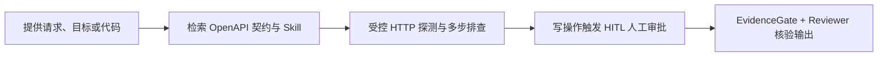

# A-Pidoc · API Doctor

**让接口联调，从反复试错变成有据可查。**

定位失败请求，核对接口约定，在安全护栏内验证修正，留下可回放的真实证据。

[](package.json)
[](src/)
[](web/)
[](https://github.com/LarryBUPT/A-Pidoc/actions/workflows/ci.yml)
[](https://github.com/LarryBUPT/A-Pidoc/releases)
[](LICENSE)

[快速开始](#-快速开始) · [可以帮你做什么](#-可以帮你做什么) · [评测与验证](#-评测与质量保障) · [文档导航](#-文档与项目导航) · [参与贡献](CONTRIBUTING.md)

---

## ✨ 为什么使用 API Doctor

接口请求失败时，问题往往藏在请求头、参数类型、接口版本升级或代码配置里；如果直接把报错丢给通用大模型，它又容易编造不存在的字段、越权触发写操作，或者在没实测验证的情况下声称“已经修复”。

**API Doctor（A-Pidoc）** 面向开发者、测试与联调人员，把 **OpenAPI 契约检索、受控 HTTP 实测、代码扫描与隔离迁移、人工审批护栏、证据门禁及全链路回放** 整合在一套全栈工作台里。你可以用浏览器可视化工作台、CLI 或 MCP 接入它，快速查清根因、验证可行修正，并把每一步真实请求与观测证据沉淀下来，方便复现与协作。

## 🧭 可以帮你做什么

| 你的场景 | API Doctor 提供的帮助 |
| --- | --- |
| **请求一直报错，不知道从哪查起** | 按需检索 OpenAPI 规范，定位 `415 / 405 / 401 / 400` 及多步依赖问题，并实测验证修正后返回 `2xx` |
| **文档看着没错，代码却调用失败** | 扫描本地仓库中的 `fetch`、`axios`、`requests`、`OkHttp` 调用点，对照接口文档发现路径、方法与字段偏差 |
| **接口要升级，担心改坏现有代码** | 对新旧 OpenAPI 做语义 Diff（删除接口、新增必填、字段类型变更），在**隔离副本**中试打补丁并运行回归测试，不污染原仓库 |
| **涉及扣款或写操作，不敢让 Agent 自动跑** | 只读排查自动放行；涉及状态变更、支付或改码测试时自动挂起，弹出 **HITL 人工审批卡片**，授权与单次操作摘要绑定 |
| **担心大模型幻觉或口头自证成功** | 每条结论必须引用带 SHA-256 摘要的真实工具观测，通过 **EvidenceGate 硬门禁** 与独立 **Reviewer** 双重核验后才能结单 |
| **想看清 Agent 每一步到底做了什么** | 提供 **Vue 3 可视化工作台**：实时 SSE 诊断流、嵌套 Trace Span 瀑布图、TTFT/Token/成本指标与逐帧轨迹回放 |
| **想在 Cursor / Claude Code 中复用能力** | 内置标准 **stdio MCP Server**，将受控 OpenAPI 检索、白名单 HTTP 探测、仓库扫描与可核验证据直接提供给外部 AI 工具 |
| **想量化验证 Agent 改完到底有没有变强** | 内置 32 端点微服务靶场、12 题固定评测集与 **V0 → V1 → V2 三组消融评测**，输出四维 Rubrics 评分与 Badcase 自动归因 |

## 🚀 快速开始

需要 **Node.js 22.19 或更高版本**和 npm。在仓库根目录运行：

```bash
npm ci
npm --prefix web ci
npm run build:all
npm run serve
```

浏览器打开 **http://127.0.0.1:3000** 即可进入全栈工作台，体验三大视图：
- **实时诊断台**：内置 8 端点电商诊断靶场，支持**免密钥 `Mock` 模式**体验完整 SSE 轨迹与 HITL 人工审批弹窗；在 `.env` 配置 `DEEPSEEK_API_KEY` 后可一键切换 **Live 模式**运行真实模型推理。
- **Trace 可观测与回放**：查看嵌套 Span 瀑布图、TTFT / Token / 成本 / 上下文压缩次数与逐帧回放。
- **消融评测看板**：查看并重跑离线 / Live 三组对照实验、A/B/C/D 四维评分与 Badcase 归因。

选择你想继续体验的方向：

| 想体验什么 | 入口 |
| --- | --- |
| 启动全栈可视化工作台（诊断 / 回放 / 评测） | `npm run serve` |
| 用命令行运行一次接口诊断任务 | `npm run cli -- run --goal "Diagnose POST /sandbox/orders"` |
| 运行 12 题 × 3 组离线消融回归（零密钥，CI 门禁） | `npm run eval:offline` |
| 用真实模型运行 3 组消融实验（需配置 `.env`） | `npm run eval:live` |
| 一键运行编译、单元测试与离线回归 | `npm run check` |
| 通过标准 stdio MCP 接入 Cursor / Claude Code | `npm run mcp` · [MCP Server 使用指南](docs/guides/mcp-server.md) |
| 配置真实大模型与环境变量 | [模型配置指南](docs/guides/model-setup.md) |

## 🔎 一次排查如何进行



底层基于 **Pi Agent（`@earendil-works/pi-agent-core`）** 驱动多轮工具调用，外层由 Harness 接管上下文预算与自动 Compaction 压缩、白名单与 SSRF 防护、单次摘要审批（`actionDigest`）以及 SHA-256 证据核验。无法确认修正安全或上游持续故障时，任务会诚实中止或转交人工接手，并把完整快照、事件流与证据留存在 `.private/` 目录中供随时回放。

## 📊 评测与质量保障

为避免“只靠肉眼感觉变好了”，A-Pidoc 在 **32 端点多域微服务靶场**与 **12 题固定标注评测集**（覆盖正向单步、多步链式、边界入参、负向防幻觉与 Indirect Prompt Injection 对抗）上内置了 **4 维度 Rubrics 评分器**（`A 过程 0.4 + B 结果 0.4 + C 表达 0.2 ≥ 80`，`D` 维风险一票否决）与 **V0 → V1 → V2 三组消融评测**：

| 评测模式 | 消融梯队（V0 裸基线 → V1 +上下文工程 → V2 完整 Harness） | 通过率 | Rubrics 均分 | 风险否决率（D 维） | 幻觉率 |
| --- | --- | --- | --- | --- | --- |
| **Offline 确定性回归**（12 题 · CI 门禁） | `V0_raw` → `V1_context` → `V2_harness` | `25.0%` → `66.7%` → **`100.0%`** | `62.3` → `92.1` → **`99.1`** | `33.3%` → `33.3%` → **`0.0%`** | `16.7%` → `16.7%` → **`0.0%`** |
| **Live 模型实测**（6 题 · `deepseek-chat`） | `V0_raw` → `V1_context` → `V2_harness` | `33.3%` → `50.0%` → **`100.0%`** | `67.8` → `88.3` → **`94.3`** | `50.0%` → `50.0%` → **`0.0%`** | `0.0%` → `16.7%` → **`0.0%`** |

详细指标定义、五模块评测体系与 Badcase 归因规则见 [Agent 评测方法论](docs/eval-methodology.md)。

## 🛡️ 使用前了解

API Doctor 当前是一个提供 Web 工作台、CLI 与 MCP 接入的实验性项目，适合学习、接口联调、契约迁移验证与 Agent Harness 评测研究。

- **请求目标需要明确允许。** 受控 HTTP 客户端执行 Host / Port 白名单与 DNS SSRF 私网拦截；报告、日志与证据会对常见凭据和敏感字段自动脱敏。
- **代码检查与迁移有范围。** 支持 `fetch`、`axios`、`requests`、`OkHttp` 的常见调用写法，以及 OpenAPI 3.x / Swagger 2.0 的常见 JSON 能力；仓库补丁与测试在隔离副本中执行，复杂业务逻辑仍需人工确认。
- **高危操作默认等待人工审批。** 涉及支付、状态变更或代码修改测试时强制挂起为 `waiting_approval`，批准与单次参数摘要绑定，防止静默执行或参数篡改。
- **离线演示与真实模型严格分开。** 免密钥 `Mock` 模式与 `eval:offline` 用于验证交互机制和 CI 回归，不代表真实模型能力；真实模型评测通过 `eval:live` 单独触发，不混入 required CI。
- **MCP 目前面向本地受控接入。** 外部宿主接入时沿用原有安全白名单与证据约束，不开放任意写操作。

## 📚 文档与项目导航

| 你想了解 | 从这里开始 |
| --- | --- |
| 怎么运行、怎么看结果 | [使用指南](docs/guides/getting-started.md) |
| 怎么配置模型 | [模型配置](docs/guides/model-setup.md) |
| 如何接入 MCP | [MCP Server 使用指南](docs/guides/mcp-server.md) |
| 系统架构与 Harness 分层设计 | [v2 架构导读](docs/v2-architecture-guide.md) |
| 评测体系、Rubrics 与三组消融方法论 | [Agent 评测方法论](docs/eval-methodology.md) |
| CI/CD 与 Release Please 发版流程 | [CI/CD 工作流规范](docs/development/CICD_WORKFLOW.md) |
| 版本变更记录 | [CHANGELOG](CHANGELOG.md) |
| 如何参与开发 | [贡献指南](CONTRIBUTING.md) |

## 📁 仓库目录

```text
A-Pidoc/
├── README.md          项目首页
├── LICENSE            MIT 开源协议
├── .pi/skills/        渐进式领域 Skills（接口诊断 / 契约迁移）
├── src/
│   ├── kernel/        Pi Agent Harness 核心（Loop / 上下文压缩 / 审批 / 证据门禁 / Multi-Agent / 可观测）
│   ├── tools/         OpenAPI 检索、受控 HTTP、仓库扫描与隔离迁移沙箱
│   ├── eval/          32 端点基准靶场、12 题评测集、4 维 Rubrics 与 V0/V1/V2 消融引擎
│   ├── server/        Hono REST + SSE 后端与内置 8 端点演示靶场
│   ├── mcp/           标准 stdio MCP Server
│   ├── cli/           CLI 入口（serve / run / mcp / eval）
│   └── shared/        安全脱敏、SSRF 策略、OpenAPI 解析与模型工厂
├── web/               Vue 3 + Vite 全栈可视化工作台
├── test/              单元测试与集成测试
├── docs/              架构导读、评测方法论、使用指南与工程规范
└── .github/           CI 与 Release Please 自动发版工作流
```

## 🤝 反馈、贡献与开源协议

欢迎通过 [Issues](https://github.com/LarryBUPT/A-Pidoc/issues) 反馈可复现的问题或提出使用建议。参与开发前请阅读 [贡献指南](CONTRIBUTING.md)。

本项目基于 [MIT License](LICENSE) 开源。
