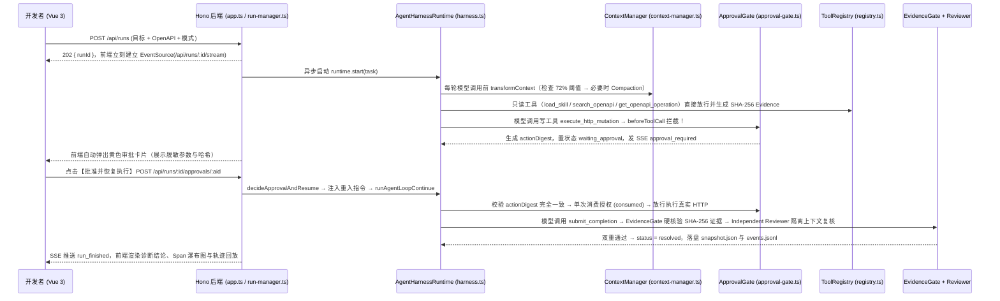

# A-Pidoc v2 白话源码链路导读（15 分钟彻底吃透全项目）

本文面向开发者与代码审阅者，用最直白的语言串起 A-Pidoc v2 的**全部 6+1 模块**与**一条任务从启动到验收的完整生命周期**。

---

## 一、为什么这样分层？（核心设计哲学）

A-Pidoc v2 彻底摒弃“确定性规则包模型壳”和“无护栏裸 Agent”两种极端，遵循 **Pi Agent（`@earendil-works/pi-agent-core@0.85.1`）** 的极简内核理念：

- **LLM（大模型）只负责认知决策**：理解故障目标、规划下一步调哪个工具、总结根因。
- **Agent Harness（工程运行时）掌握全部确定性边界**：预算与重试、上下文压缩、技能按需加载、权限审批、隔离沙箱、SHA-256 证据核验、全链路观测。

整个项目由 **6 个后端模块 + 1 个 Vue 3 前端** 组成，职责零重叠：

| 层级 | 目录 | 核心职责 | 关键文件 |
| --- | --- | --- | --- |
| 1. 共享基础层 | `src/shared/` | 安全脱敏、SSRF/白名单、OpenAPI/curl 解析、HTTP 客户端、模型工厂与重试 | `request-policy.ts`, `redaction.ts`, `http-client.ts`, `model-factory.ts` |
| 2. 核心引擎层 | `src/kernel/` | Pi Agent Loop 驱动、上下文压缩、Skill 渐进加载、审批状态机、证据门禁、Multi-Agent、四层可观测性 | `harness.ts`, `context-manager.ts`, `approval-gate.ts`, `evidence-gate.ts`, `multi-agent.ts`, `telemetry.ts` |
| 3. 工具与沙箱层 | `src/tools/` | 统一 Zod 校验与风险分级、OpenAPI 检索、受控 HTTP、仓库扫描/契约 Diff/隔离补丁与测试 | `registry.ts`, `openapi-search.ts`, `http-runner.ts`, `workspace-tools.ts`, `core-tools.ts` |
| 4. MCP 协议层 | `src/mcp/` | 标准 stdio MCP Server，供 Cursor / Claude Code 等外部工具复用原子能力 | `server.ts` |
| 5. 后端服务层 | `src/server/` | Hono REST API + SSE 实时事件流 + 审批回调 + 内置 8 端点电商靶场 | `app.ts`, `run-manager.ts`, `demo-sandbox.ts` |
| 6. 入口与评测层 | `src/cli/` & `src/eval/` | 4 命令简洁 CLI（`serve/run/mcp/eval`）+ Raw Pi vs Harness Pi 5 场景对照评测 | `cli/index.ts`, `eval/runner.ts` |
| 7. 前端工作台 | `web/src/` | Vue 3 + Vite 全栈界面：实时诊断与审批弹窗 / Trace 回放器 / Eval 看板 | `App.vue` |

---

## 二、一条任务的完整执行链路（面试手画架构图必备）

以用户在 Vue 前端启动一次「支付扣款接口排错（触发人工审批）」为例，数据流按以下 8 步精准流转：

---

## 三、四个核心机制的“源码级”速记要点

### 1. Context Engineering（`src/kernel/context-manager.ts` + `skill-loader.ts` + `openapi-search.ts`）
- **渐进式 Skill**：启动时只在 System Prompt 放技能目录（名称 + 一句话描述），模型需要时调 `load_skill` 读取 `.pi/skills/<name>/SKILL.md` 正文。
- **OpenAPI 检索**：面对几十/上百个接口的规范，`OpenApiIndex` 按路径、方法、OperationId、请求体字段名做加权检索，只返回 Top-K，不把整份 JSON 塞爆上下文。
- **结构化 Compaction**：每轮发给 LLM 前估算字节数；超过 `maxContextBytes * 72%` 时，保留「首条目标 + 结构化历史摘要（附全部 Evidence ID 索引）+ 最近 6 条消息」，并记录 `CompactionRecord` 到 Trace。

### 2. Human-in-the-Loop 防篡改审批（`src/kernel/approval-gate.ts`）
- 风险分级：`read` / `network_read` 自动放行；`write` / `network_write` 在 `production` 环境硬阻断，在 `sandbox/staging` 强制挂起审批。
- **防篡改与防重放**：审批时计算 `actionDigest = sha256(canonicalJson({ toolName, args }))`。批准后恢复执行，模型必须重发**完全相同参数**的工具调用，授权状态由 `approved` 原子转为 `consumed`（一次性消费），彻底杜绝“批准改 A 却偷偷改 B”或重复扣款。

### 3. Multi-Agent 协同（`src/kernel/multi-agent.ts`）
- **按复杂度分级**：简单排错由单 Lead Agent 高效闭环，节省 Token 与时延。
- **Specialist Subagent（委派只读研究）**：`delegate_specialist` 启动隔离上下文、仅挂载 `read` 工具、最多 4 轮的子 Agent，把大文档/多文件扫描的噪声消化在子上下文里，只把精炼简报与 Evidence ID 返回给主 Agent（Hierarchical Context Routing）。
- **Independent Reviewer（独立反思核验）**：硬门禁 `EvidenceGate` 通过后，启动无任何工具的独立子 Agent 审核逻辑一致性；若返回 `revise`，将反馈注入主看板触发最多 1 轮反思纠错；若返回 `block`，升级人工接管。

### 4. 四层可观测性（`src/kernel/telemetry.ts` + `session-store.ts`）
1. **Structured Tracing**：嵌套 `TraceSpan` 树（`run` → `llm_call` / `tool_call` / `compaction` / `approval_wait` / `evidence_gate` / `subagent_*`），可视化瀑布耗时。
2. **Metrics**：实时采集总耗时、TTFT 首字延迟、输入/输出 Token、估算成本、工具失败率、压缩次数、审批等待耗时、子 Agent 次数。
3. **Trajectory & Replay**：每个 Run 独立落盘 `snapshot.json`（原子写入）与 `events.jsonl`，前端支持拖动时间轴逐帧回放定位故障归因。
4. **Live SSE**：Hono `streamSSE` 先补发历史事件再无缝续接实时推送，支持断线重连不丢进度。
